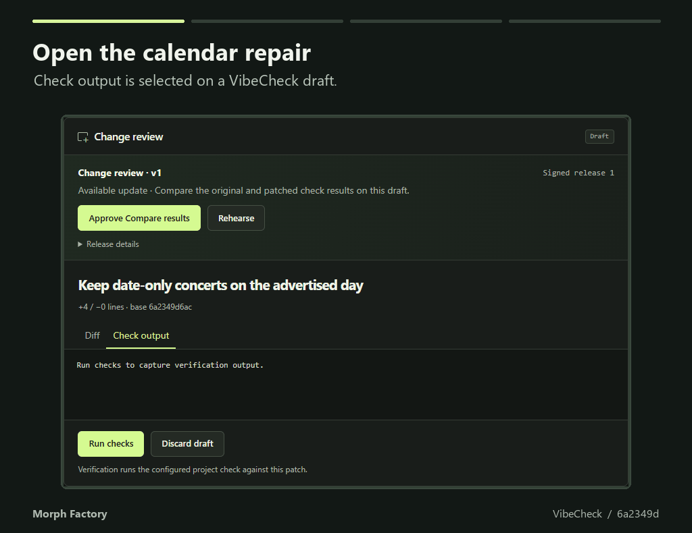

# Morph Factory

[](https://github.com/marioG1025/morph-factory/actions/workflows/check.yml) [](LICENSE)

A local review desk for turning a product idea or a bug into a tested Git change. Open a draft, inspect its patch, and run the same check against the original and candidate. Save the changes you want on a review branch.

**The desk can change while you’re using it.** Approve **Compare results** and the server enables a new operation. The matching control appears in the draft you already have open. Your selected tab, patch, and browser document survive the update. This is the first factory feature built on Nikhil Ajay Kadalge’s [Live Layer Protocol](https://github.com/nik190799/live-layer-protocol).



## Try it on a real product

You need Python 3.11+, Git, Node.js 22+ and npm. On Windows, `python` or `py -3` can stand in for `python3`.

```sh
git clone https://github.com/marioG1025/morph-factory.git
cd morph-factory
python3 vibecheck.py
```

The launcher prepares the pinned public VibeCheck checkout, opens a calendar-date patch and starts the desk on loopback. First use requires internet for the product checkout and the locked WebSocket dependency. The demo works without an AI subscription, API keys or Spotify credentials. [Open the local desk](http://127.0.0.1:8765/)

1. In **Change review**, select **Check output**. For a second view of the release, open the desk in another tab and select **Diff** there.
2. Click **Rehearse**. The factory tries the candidate on copies of the active browser and server state. Click **Approve Compare results**. Both open tabs gain the action and keep their own selection.
3. Click **Run comparison** on the draft. Four date-only concert cases change from failed to passed. Two timestamp controls pass on both sides. Expand **Original output** or **Patched output** to inspect what each checkout returned.
4. Open **Release details → Download experiment receipt**, or click **Restore original review** to withdraw the capability from the open desk. **Run checks** and **Save review branch** are separate, explicit steps for keeping the product patch.

## Bring your own repository

```sh
python3 server.py --repo /path/to/your-product --check python -m unittest discover -s tests
```

Supply a check that works in a clean checkout of your project. On an empty desk, **Check current commit** finds failing checks before you have a patch. Choose **Prepare proposal** on a failure to edit or copy the evidence, or ask a signed-in Codex CLI to draft a fix. **Add your patch** also accepts a Git diff. The factory captures the base commit, patch digest and verification result before saving a local branch. Publishing a GitHub draft PR is a separate command. Project checks run with your OS account’s permissions. [Operator guide](docs/operator-guide.md) · [Evidence-to-proposal walkthrough](docs/experiments/check-intake.md)

To keep the desk working as a product evolves, enable **Watch for new commits**. You can opt in to running the project check on newly observed commits. Open tabs share the same check, and a failure appears under Findings for you to review. [Two-tab watch experiment](docs/experiments/watch.md)

## What LLP does here

| During a release | Implementation |
| --- | --- |
| Decide which behavior travels together | A signed manifest names the client `review` module and server `reviewService` module by SHA-256. |
| Test the proposed change | A shadow browser host preserves the draft and pane. A shadow server host exercises the release and compare operations. Approval binds to the digest of the complete candidate manifest. |
| Update the open desk | The LLP server installs the server module, persists the release and offers it over WebSocket. Each connected client verifies the signature, loads its Wasm, renders, and acknowledges the version. |
| Run a real product check | The approved layer invokes the remote compare operation. The Python desk checks the active grant and executes trusted commands against separate Git checkouts. |
| Restore the old behavior | The operator publishes a newer signed version that references the original modules. The draft remains open. |

The factory integrates LLP into its own Change review panel. The checkout under review can use its existing frontend and backend. Signing keys and active releases stay in checkout-specific local state. This version supports a single local operator. [Integration report for LLP maintainers](docs/llp-integration.md) · [Implementation and trust model](runtime/README.md)

## Evidence and reproduction

| What to inspect | Where to go |
| --- | --- |
| Product thesis, competing workflows and paid-pilot criteria | [Current thesis](docs/product-thesis.md) · [Original founder research (PDF)](docs/research.pdf) |
| Tested VibeCheck revision, before/after results, and downloadable example | [Experiment notebook](docs/experiments/README.md) |
| An actual model-generated repair of the calendar bug | [Two attempts, exact patch, and independent replay](docs/experiments/agent-proposal.md) |
| A draft PR created by the factory on its own repository | [Example PR with review evidence](https://github.com/marioG1025/morph-factory/pull/1) |
| Independent JS/Go host parity across approval and restore | [Six reproducible checkpoints](docs/experiments/go-host.md) |
| Canary delivery across preview and stable channels | [Fleet experiment and ACK findings](docs/experiments/fleet.md) |
| Exact LLP revision, local integration changes and license | [Upstream provenance](THIRD_PARTY.md) |
| Change the review layer or add your own tests | [Layer source and build](layers/review/README.md) · [Contributing](CONTRIBUTING.md) |

Morph Factory is an independent experiment. The factory is published under the [Apache License 2.0](LICENSE). The LLP reference host, SDK and example layers retain their upstream attribution.
