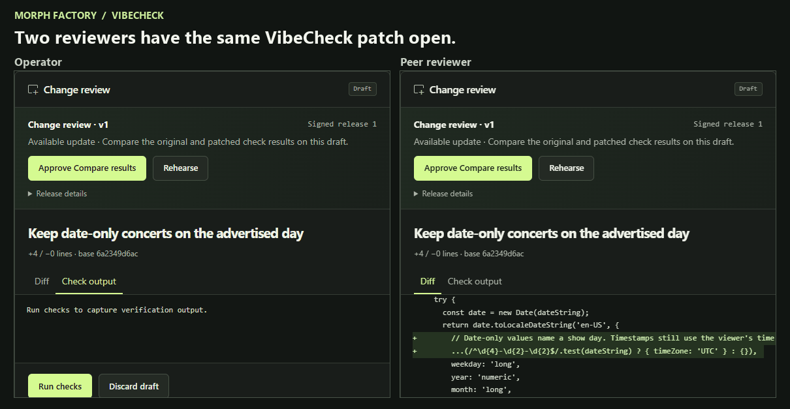

# One measured comparison, two open desks

Run **Compare results** on a VibeCheck draft in one tab. A second tab on the same draft shows the same two check outputs, four fixes and two unchanged controls. The second reviewer can keep a line selected in the diff while the result arrives.



The 24-second recording follows one operator on **Check output** and a passive reviewer on **Diff**. It shows the two panels captured throughout one local run. The operator runs one comparison, the peer runs zero, and both browser documents survive the restore.

## What crosses the wire

1. Python saves the report with an opaque run ID after checking the active release, base commit and patch. The local server host persists one LLP shared key, `shared/review/comparison`, and flushes the update to subscribers.
2. The value is a JSON string with four fields. `run` identifies this particular execution, `base` is the base Git commit, `digest` is SHA-256 of the UTF-8 diff and `releaseVersion` identifies the release that approved comparison. A connected desk receives a `shared` delta. A reconnecting desk receives the latest value in its full shared-state snapshot. [Reference client adapter](../../runtime/vendor/llp/remote-client.mjs)
3. The browser subscribes to that key through upstream `connectServer`. Upstream `LiveHost.applyShared` updates the mirror and requests a render. For a matching marker, the factory makes a same-origin `GET /api/state` to retrieve the authoritative comparison document. Diffs, test names, detailed output and source paths travel through the native desk HTTP response. The LLP frame contains only the marker. [Browser integration](../../ui/layers/review-client.js)
4. The browser checks the run, base, diff, release and draft generation again after the read. It then projects report availability into the existing Wasm review layer. The native renderer displays the report on the open draft. A duplicate marker reuses an in-flight read. A late response for a cleared and recreated draft is ignored, including when both drafts contain identical diff text.

The second tab never requests another product check. A previously measured report on the same draft retains its original **Measured on release** label until a newer measurement arrives. The receipt exporter includes only a comparison matching the exported release.

## Observations

The two-tab browser acceptance test captured one four-field delta, one observer document read and one comparison POST from the initiating tab. It checked that each tab displayed the same run, that the focused diff retained its selection and scroll, and that the observer kept its browser document. A separate test delivered duplicate notifications and held a native response while the draft was discarded and recreated. [Acceptance test](../../tests/browser/review-acceptance.mjs) · [Late-response regression](../../tests/browser/review.test.mjs)

A short Windows Chromium run completed eleven approval, measurement and restore cycles in 38 seconds. On eight cycles the observer received a delta. On three cycles the test closed its own observer socket, confirmed one remaining server connection through approval and measurement, then reconnected the same browser document. All three full snapshots led to the matching result. No passive tab started a comparison.

## Reproduce

Set up the [browser dependencies](../../tests/browser/README.md) and run these commands from the factory root.

```sh
npm run test:acceptance --prefix tests/browser
node tests/browser/soak.mjs
```

The [soak runner](../../tests/browser/soak.mjs) takes its duration in `MORPH_SOAK_MINUTES` and interval in `MORPH_SOAK_INTERVAL_SECONDS`. By default it disconnects the observer on every third cycle. Set `MORPH_SOAK_OFFLINE_EVERY=1` to exercise full-snapshot catch-up on a single cycle. The output records the peer run ID and whether the observer received a delta or full snapshot.

To record the paired panels yourself, use the same browser setup and install Pillow in a Python environment for GIF encoding. The capture starts its own isolated desk and saves paired screenshots to the scratch directory you supply. The encoder adds reviewer labels and captions, preserving the elapsed time between the captured frames.

```sh
node scripts/capture-peers.mjs ../peer-recording
python -m pip install Pillow
python scripts/render-peers.py ../peer-recording ../peer-review.gif
```
