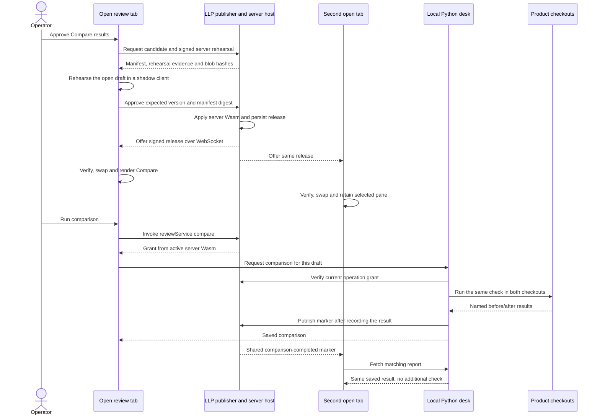

# Live Layer Protocol in Morph Factory

Morph Factory is a local Git review application. We used Nikhil Ajay Kadalge’s LLP reference implementation to make **Change review** an updatable part of the factory itself. The operator can introduce a server-backed comparison tool to an existing product draft while its verification command is still running. The target product only needs a Git checkout and a usable check command. [Pinned LLP reference](https://github.com/nik190799/live-layer-protocol/tree/d14ebf9f8d17a45a3619231d4a9c63c00845bf96) · [Watch the recorded update](../README.md#try-it-on-a-real-product)

## Follow one release

The [offline replay](experiments/offline-replay.md) packages one actual review → compare → restore sequence into a single file. It uses the same upstream host core with client and server placement in one browser, verifies the recorded signatures and runs both Wasm modules. The sequence below describes the full local application, including the live WebSocket and product checkouts.

The Python endpoint consults the current server layer before starting the work and before attaching results. The only public actions used in this walkthrough are local to the desk. The source for the [client](../layers/review/review.ts), [server](../runtime/review-host.mjs), and [Git comparison](../comparison.py) shows where each responsibility lives.

**What can change live?** A release can compose the existing view nodes, alter review state and actions, and introduce behavior in its paired server module. The operator approves that pair. The browser shell already knows how to display a diff, check log and comparison document. A future layer that needs an entirely new native document type also needs renderer support. [Review renderer](../ui/layers/review-renderer.js) · [Layer ABI](../layers/review/README.md)

## Findings for a host implementer

The [worker lifetime experiment](experiments/worker-lifetime.md) includes a small probe that runs the signed review pair repeatedly on the reference host. Chromium exhausted Wasm memory during a local rehearsal with worker reuse. Terminating retired workers through the upstream hook let the same workload complete 72 approval/restore pairs. The [adoption measurements](experiments/adoption.md#after-the-worker-lifetime-fix) include last-tab timings with both policies.

| Observation | Reproduction |
| --- | --- |
| A JavaScript client and unmodified Go client agreed on the complete rendered node tree and stored state at six checkpoints. The Go client reused the original blob on restore. | [Cross-runtime parity](experiments/go-host.md) |
| The convenience fleet rollout omits the signed placement and capability fields needed by this app. Field-preserving publish works. A relay ACK can arrive before the chosen desk ACKs. Widening can produce a stale-version NACK on an already-updated client. | [Preview and stable channels](experiments/fleet.md) |
| Closing a link while a reconnect timer was pending could open a replacement socket. A guard in the vendored adapter fixes it. A second small delta lets the server explicitly bind loopback. | [Exact client delta](upstream/remote-client.mjs.patch) · [Server delta](upstream/server-host.mjs.patch) |
| The server activates its in-memory lane before finishing persisted release writes and relay. A storage exception requires recovery from the signed release on disk. We injected write failures before and after the save and retried the original approval. | [Recovery and ordering](../runtime/README.md#bootstrap-persistence-and-trust) · [Executable tests](../runtime/tests/review-host.test.mjs) |
| A compatible browser swap can preserve focus, selection, scroll and the draft while introducing a real operation. The integration supplies stable DOM identity and references to native diff and log documents. | [Layer ABI and native renderer](../layers/review/README.md) · [Real browser suite](../tests/browser/README.md) |
| The upstream shared read cache can notify a second desk of completed work. The server publishes one small marker after saving the comparison. The peer uses its draft identity and run ID to fetch the matching report locally. A reconnect can receive the marker in a full snapshot. | [Server delivery](../runtime/review-host.mjs) · [Client subscription](../ui/layers/review-client.js) · [Two-tab assertions](../tests/browser/review-acceptance.mjs) |
| A 264-byte LLP delta identified a saved VibeCheck run. On eight open documents, the operator ran one product check and the seven peers each fetched one matching report. A stopped process between saving and notifying recovered the run when its peers rejoined. | [Payloads and eight-tab test](experiments/shared-comparison.md) · [Interruption before notification](experiments/desk-restart.md) |
| A Python-side release check alone left a short race between accepting the old grant and saving its report. An HTTP restore could commit in that gap. The desk now serializes the brief final save with release transitions while the project command continues outside the lock. | [Two-request ordering test](../tests/test_release_order.py) · [Withdraw during a real build](experiments/concurrent-build.md) |

The long runs also exercised worker eviction, real credential expiry and publisher restarts. The upstream connection exposes diagnostic arrays containing sent and received frames. The factory retains its accepted signed envelope and periodically trims those arrays in the browser. The endurance measurements report whole-process memory for the observed local test groups. [Endurance report](experiments/endurance.md) · [Factory transport integration](../ui/layers/review-client.js)

## What to open first

**Live lab** on the factory floor exposes a smaller upstream example. In Edge we entered an unfinished note, induced an Add failure on the signed v1 task layer, upgraded to v2, then repeated the failure. Both recoveries preserved the checklist, completion flags and note. The recovered v2 accepted the note as a new task. [Lab implementation and recovery checks](../ui/lab/lab.js)

- **For the operator experience**, run `python3 vibecheck.py` and approve Compare results on the preloaded calendar repair. [Quickstart](../README.md#try-it-on-a-real-product)
- **For an independent check**, run `node scripts/inspect-receipt.mjs docs/experiments/receipts/vibecheck-calendar.json --bundled`. This verifies the signed release, shipped Wasm and signed server rehearsal. The recorded counts are an unsigned observation. [Example receipt](experiments/receipts/vibecheck-calendar.json)
- **For repeatable research**, the notebook records product checks, local adoption measurements and paired-host findings. The provenance inventory lists every upstream file we included. [Experiment notebook](experiments/README.md) · [Attribution and inventory](../THIRD_PARTY.md)

This is an independent application experiment on the pinned reference revision. The default desk uses one operator and one channel on loopback. The multi-channel fleet and independent Go client are opt-in research probes.
